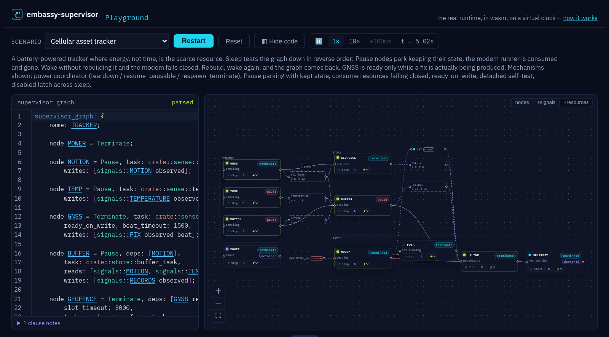
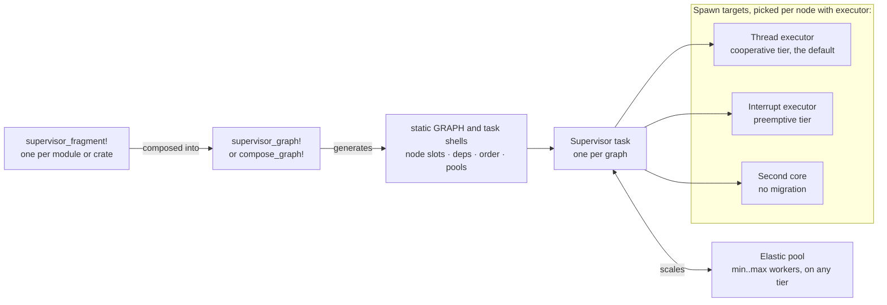
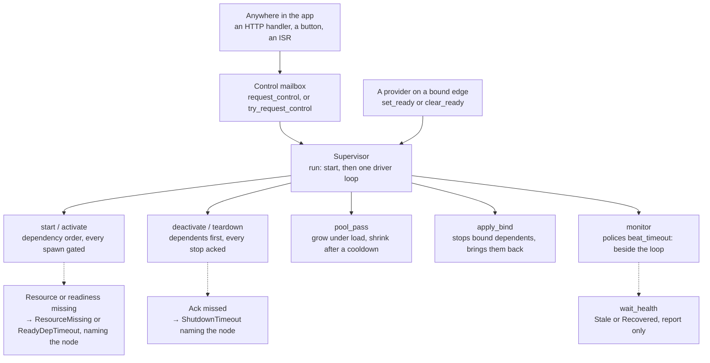
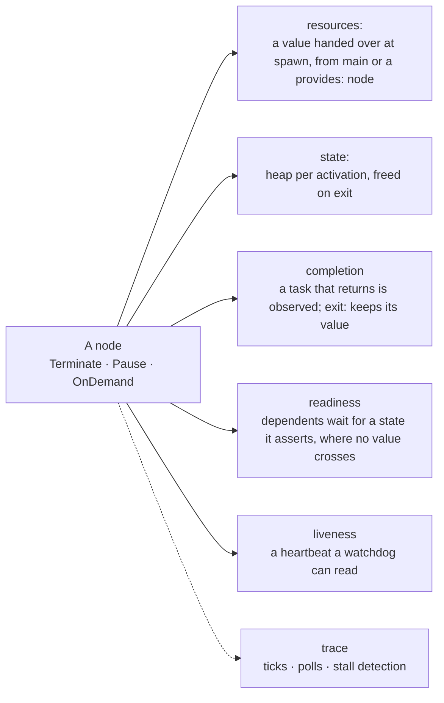

<div align="center">

# embassy-supervisor

**Run-time supervision for bare-metal async Rust.**

Dependency-ordered task lifecycle, elastic pools, runtime control and verified dataflow
for [embassy](https://embassy.dev) firmware. No kernel, no per-task stacks, no allocator.

[](https://crates.io/crates/embassy-supervisor) [](https://docs.rs/embassy-supervisor) [](https://github.com/cedrivard/embassy-supervisor/actions/workflows/ci.yml) [](#compatibility) [](#compatibility) [](#license)

[Website](https://embassy-supervisor.github.io/) · [Playground](https://embassy-supervisor.github.io/playground/) · [Library reference](supervisor/README.md) · [API docs](https://docs.rs/embassy-supervisor) · [Demo firmware](firmware/README.md)

[](https://embassy-supervisor.github.io/playground/)

</div>

## Overview

embassy gives firmware an RTOS-like task model at close to bare-metal cost. It does not
provide the lifecycle: which task starts before which, what stops before sleep, how workers
scale under load, how an update is applied safely.

`embassy-supervisor` is that layer. You declare the task graph once; the supervisor brings
it up in dependency order, tears it down in reverse, scales pools, and serves runtime
control, across thread-mode executors, interrupt executors and a second core.

- **Checked at compile time.** Cycles, unknown or duplicate deps, duplicate names and bad
  pool bounds are compile errors. The topological order is computed during expansion.
- **Fails closed.** A missing resource, a dependency that never becomes ready and a missed
  shutdown ack each return a `NodeFault` naming the node. None of them panics.
- **Small and portable.** `no_std`, `#![forbid(unsafe_code)]`, no allocator, HAL-agnostic.
  Depends only on embassy crates and `portable-atomic`.
- **Pay for what you use.** Control plane, pools, dataflow, tracing and health are Cargo
  features. A minimal build is the dependency-ordered core.

## Quick start

```sh
cargo add embassy-supervisor
```

```rust
use embassy_executor::Spawner;
use embassy_supervisor::{Supervisor, TaskNode, supervisor_graph};

// One declaration generates the node statics and a single `GRAPH` bundling the
// node slots, deps and compile-time order. APP depends on NET, so it starts after it.
supervisor_graph! {
    node NET = Terminate, task: net_task;
    node APP = Terminate, deps: [NET], task: app_task;
}

async fn net_task(node: &'static TaskNode) { /* ... */ }
async fn app_task(node: &'static TaskNode) { /* ... */ }

#[embassy_executor::task]
async fn supervisor_task(spawner: Spawner) {
    let sup = Supervisor::new(&GRAPH); // infallible: a cycle is a compile error
    if let Err(fault) = sup.start(&spawner).await {
        panic!("supervisor: {fault}"); // names the node and the cause
    }
}
```

### With runtime control and pools

`start()` brings the graph up and returns. With the `control` or `pool` feature, `run()`
replaces it: it brings the graph up, then serves control commands and pool scaling until
a fault.

```sh
cargo add embassy-supervisor --features control,pool
```

```rust
use embassy_supervisor::{ControlOp, request_control};

// In the supervisor task:
let fault = sup.run(&spawner).await;
panic!("supervisor: {fault}");

// Anywhere else, such as an HTTP handler. Stopping NET stops APP first.
request_control(&NET, ControlOp::Deactivate).await;
```

Next steps:

- Try a graph in the [in-browser playground](https://embassy-supervisor.github.io/playground/),
  which runs the real crate compiled to WebAssembly.
- Read the [library reference](supervisor/README.md): model, lifecycle matrix,
  `supervisor_graph!` DSL, dataflow supervision and recipes.
- Flash the [demo firmware](firmware/README.md) on an RP2350.

## Architecture

### From declaration to running tasks



The graph is validated where it is written. Fragments let a module or a whole crate declare
its own slice, and `name:` lets one binary hold several graphs, so a subsystem can be a
sub-graph that an app state machine brings up and drops per phase.

Each node runs on the executor its `executor:` annotation names:

| Tier | Scheduling | Typical use |
|------|------------|-------------|
| Thread executor (default) | Cooperative, yields at `.await` | Networking, servers, housekeeping |
| Interrupt executor | Preempts the thread tier | Latency-sensitive sensor and control work |
| Second core | Own thread executor, no task migration | Compute load, whole pools |

The supervisor never runs task code itself. It spawns, parks and tears down tasks on these
tiers and scales the pools.

### Run-time behavior



Both failure edges are returned values. Bring-up refuses to spawn a task whose peripherals
or dependencies are not ready, and a node that misses its shutdown ack is named to the
application, which decides whether to retry, log or reset. The monitor only reports: a
stalled node arrives as a `Stale` event, and the supervisor does not stop it.

The mailbox needs the `control` feature, pools `pool`, bound edges `bound-deps` and the
monitor `liveness-monitor`.

### Anatomy of a node



Only the mode is required. What each operation does per mode is in the
[lifecycle reference](supervisor/README.md#lifecycle-reference).

## Features

Rows marked *default* need no extra Cargo feature.

| Capability | Cargo feature | Description |
|------------|---------------|-------------|
| Ordered bring-up and teardown | *default* | Compile-time order up, reverse order down |
| Lifecycle modes | *default* | `Terminate`, `Pause` and `OnDemand` |
| Executor placement | *default* | `executor:` targets an interrupt tier or a second core |
| Resource threading | *default* | `resources:` hands owned values to a task at spawn |
| Runtime control | `control` | A stop cascades to dependents, a start to dependencies |
| Elastic pools | `pool` | Workers grow under load and shrink after a cooldown |
| Readiness gating | `readiness` | `deps: [NET ready]` waits for `set_ready()` |
| Restart | `restart` | Restarts a node together with its dependents |
| Restart budget | `restart-intensity` | `restart_budget: 3 in 60000` faults a crash loop |
| Settings-gated bring-up | `enabled-if` | `enabled_if:` decides at `start()` if a node comes up |
| Declared dataflow | `coupling` | `reads:` and `writes:` name the signals tasks exchange |
| Derived dataflow | `dataflow` | `#[dataflow]` derives the tables from the task body |
| Polled liveness | `coupling-observe` | A declared write is polled as the node's heartbeat |
| Heartbeat | `liveness` | `beat()` and a staleness check per node |
| Watchdog gate | `liveness-monitor` | `GRAPH.all_fresh()` gates the hardware watchdog feed |
| Lifecycle events | `lifecycle-events` | Every start, stop, exit and fault, named by node |
| Bring-up breadcrumb | `breadcrumb` | Names the node that hung bring-up, after the reset |
| Tracing | `trace` | CPU ticks and poll counts per task, idle time per executor |

The complete list is under
[Cargo features](supervisor/README.md#cargo-features).

The supervisor does not allocate, own a HAL, manage power states or catch panics. Pair it
with a hardware watchdog for crashes and the liveness heartbeat for stalled tasks.

## When to use it

The supervisor pays off on devices that run several interdependent services and have to
manage power and updates:

- **Battery-powered sensor nodes**: bring the radio and stack up in order, sample, publish,
  tear down, deep-sleep.
- **Gateways and edge hubs**: strict start-up order, elastic worker pools, runtime
  reconfiguration.
- **Building and motion controllers**: a preemptive control tier beside cooperative
  telemetry, with graceful degradation.
- **Field-updatable products**: an update drains live services, frees resources, swaps,
  and rolls back on failure.

It composes with a fallible heap (stopping a subsystem returns its memory), deep-sleep
power management (services drain in dependency order before the rails drop) and A/B OTA
update with rollback. The demo firmware runs the OTA path end to end.

## Demo firmware

[`firmware/`](firmware/) is a complete RP2350 application that exercises every part of the
supervisor:

- USB networking with an HTTP control and observability plane
- An elastic pool of keep-alive workers
- A heartbeat on the interrupt-priority tier and a control-started compute load on the
  second core
- OTA update with A/B swap and rollback

Build and run steps, the per-task breakdown and a guide to the observability data are in
[`firmware/README.md`](firmware/README.md).

## Tooling

Two host tools read a graph straight out of its Rust source: `supervisor-mermaid` draws it
as a Mermaid flowchart, and `supervisor-lint` reports signals that are read but never
written, or written but never read.

```sh
cargo install embassy-supervisor-tools
cd firmware && supervisor-mermaid
```

Prebuilt binaries for Linux, macOS and Windows are attached to each
`embassy-supervisor-tools-v*` [release](https://github.com/cedrivard/embassy-supervisor/releases).
Options and output formats are in [`supervisor-tools/README.md`](supervisor-tools/README.md).

## Workspace

| Crate | Description |
|-------|-------------|
| [`supervisor/`](supervisor/) | The `embassy-supervisor` library. [Reference](supervisor/README.md) |
| [`supervisor-macros/`](supervisor-macros/) | Proc-macros: the graph declaration and the `#[dataflow]` attribute |
| [`supervisor-syntax/`](supervisor-syntax/) | The graph DSL's parser and AST, shared by the proc-macros and the tooling |
| [`supervisor-observe/`](supervisor-observe/) | Observation traits and the `Counted` wrapper for signal libraries |
| [`supervisor-tools/`](supervisor-tools/) | The `supervisor-mermaid` and `supervisor-lint` host tools |
| [`firmware/`](firmware/) | The demo application |
| [`bootloader/`](bootloader/) | The embassy-boot A/B bootloader the demo's OTA swaps against |

## Compatibility

`#![no_std]` and `#![forbid(unsafe_code)]`. The minimum Rust version and the embassy
versions each release targets are listed under
[no_std / MSRV](supervisor/README.md#no_std--msrv) in the library reference.

Upgrade notes are in the [migration guide](supervisor/README.md#migration) and the crate
changelogs.

## License

Licensed under either of [Apache License, Version 2.0](LICENSE-APACHE) or
[MIT license](LICENSE-MIT) at your option.
