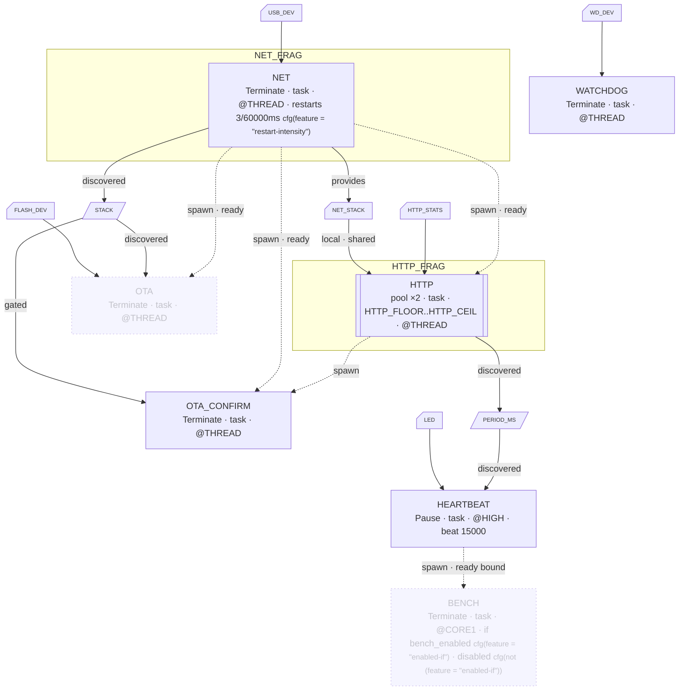

# embassy-supervisor demo firmware (RP2350)

An [embassy](https://embassy.dev) application for the RP2350 that runs an
[`embassy-supervisor`](../supervisor/README.md) task graph on real hardware:
USB networking, an HTTP control and observability plane, an elastic worker
pool, a cross-core benchmark load, and an A/B OTA update path. The supervisor
owns the orchestration; each task stays a thin wrapper around the hardware or
protocol it manages.

## The supervised task graph

The graph is composed from module-owned fragments: `net.rs` and `http.rs`
declare their slices with `supervisor_fragment!`, and `main.rs` assembles
them with `compose_graph!`. Everything reaches one `supervisor_graph!`
expansion, so cross-fragment dependencies (`http` on `net`), slot assignment,
the topological order, and the trace hooks are computed over the whole graph;
a dependency cycle is a compile error wherever its two ends are declared.

<!-- supervisor-mermaid:start -->

<!-- supervisor-mermaid:end -->

The `http` pool is both the worker pool and the control plane: each worker is
an HTTP/1.1 keep-alive server, and the pool grows under concurrent load.

### Executors

Four executors. The supervisor runs on its own interrupt tier, above everything
it polices; the graph's `default executor THREAD;` line puts every node that
says nothing else in thread mode, and a node's placement is otherwise one
`executor:` field:

| Graph slot | Executor | Runs | Nodes |
|---|---|---|---|
| *(the supervisor's own)* | `InterruptExecutor` on `SWI_IRQ_1` at priority P1 | preempts both tiers below; below the hardware handlers at P0 | the supervisor task only (the `trace-self` "supervisor" row) |
| `HIGH` | `InterruptExecutor` on `SWI_IRQ_0` at priority P2 | preempts the thread executor | `heartbeat` |
| `THREAD` *(the graph default)* | core-0 thread executor (`#[embassy_executor::main]`, published with `spawner.make_send()`) | thread mode, core 0 | `watchdog`, `net`, `http0..1`, `ota`, `ota-confirm` |
| `CORE1` | thread executor on core 1 (`spawn_core1`; publishes a `SendSpawner` into the slot) | core 1 | `bench` |

The supervisor runs on its own interrupt tier at priority P1, so it keeps
reporting even when the thread executor is hogged. The watchdog stays in thread
mode because an unconditional feed would mask the hang it is meant to catch.
The `NET_STACK: shared local` slot is legal on `THREAD` because both `net` and
`http` declare it on the default executor. `OTA` and `ota-confirm` share the
same stack through internal accessors, so they also stay on `THREAD`.
Because the supervisor is on an interrupt tier, a stop ack for `bench` on core
1 would be pended in core 1's NVIC and lost. `main.rs` relays it: the SWI
handlers ring core 0's doorbell when they run on core 1, and core 0's
`SIO_IRQ_BELL` handler re-pends the tier's IRQ.
### Nodes

| Node | Mode | Deps | Executor | Boot state | What it demonstrates |
|---|---|---|---|---|---|
| `watchdog` | Terminate | none | thread | started | Detached daemon: feeds the bootloader's 8 s rollback watchdog every 2 s; detached, so no cascade or respawn ever stops it. With `feed-gate` the feed is withheld while a policed node is stale (`GRAPH.all_fresh()`), so a stalled `heartbeat` resets the chip. Warns on trace stalls (any poll over 100 ms), logs liveness events, stashes the supervisor's breadcrumb in watchdog scratch every pass, and resets the chip on `POST /api/reboot`. Its feed runs on its own deadline, so no event stream can postpone it. |
| `net` | Terminate | none | thread | started | Reclaimable subsystem: heap-allocates every USB and network buffer on start (11,044 B total, measured as `heap_free` before and after its boxes), frees them on stop. Root of the data plane: stopping it tears `http` and `ota` down first, then returns the heap. USB peripheral threaded from `main` via `resources:`; restored on stop, re-taken on restart, no `steal()`. `restart_budget: 3 in 60000`: a fourth restart inside a minute is refused as a restart storm. |
| `heartbeat` | Pause | none | `HIGH` | started | Pause/Resume demo: parks and keeps its LED pin. Blinks the LED and beats on every blink edge (every 5 s while the LED is held steady; `beat_timeout: 15000`), survives thread-tier stalls because it is on `HIGH`, and exposes `POST /api/heartbeat?ms=` to change the blink period. |
| `http0` | Terminate | `net ready` | thread | started | Pool floor: always on while `net` is up. Stopping the floor seeds a whole-pool stop. |
| `http1` | OnDemand | `net ready` | thread | stopped | Elastic burst worker: the pool (`min: 1, max: 2`, `DeferredShrink` with a 4 s cooldown) grows it when every running worker is busy, shrinks it after the cooldown. Each worker owns one socket and heap I/O buffers, so scaling stays inside the fixed `StackResources` socket budget. |
| `ota` | Terminate | `net ready` | thread | **disabled** | Control-started update path: detaches itself (uninterruptible), drains the pool and `net`, decodes a zstd image into DFU, arms the swap, resets. FLASH threaded from `main` via `resources:`; `mark_booted` (the `ota-confirm` path) borrows the same slot manually with `take()`/`restore()`, so the two FLASH users exclude each other at runtime. `ota` confirms the running image itself before it stages a new one. Reports its phase via `report_status`. |
| `bench` | Terminate | `heartbeat ready bound` | `CORE1` | **disabled** (started when the boot flag is set, under `enabled-if`) | Multi-core placement: the core-0 supervisor spawns and stops it on core 1 through the `CORE1` spawner slot. The graph's one bound edge: it runs only while the heartbeat is actively blinking; pausing the heartbeat stops it, resuming restarts it. Returns its slice count into the `exit:` slot (`GET /api/bench`). Under `enabled-if` its `disabled` becomes `enabled_if: crate::bootflag::bench_enabled`, a flag in watchdog scratch 5 that survives a reset (`POST /api/bootflag?bench=on`). |
| `ota-confirm` | Terminate | `http` (pool floor), `net ready` | thread | started | Run-last ordering: depending on the pool name resolves to the floor member, so it spawns last in topological order. Detaches, waits for the USB link and for a worker's first complete HTTP response, then calls `mark_booted` to confirm the image and exits. An update whose link or HTTP plane never works is never confirmed, and its next reset rolls it back. If `ota` holds the flash at that moment the image is already confirmed and `ota-confirm` only logs it. |

### Supervisor features exercised

| Supervisor feature | Where |
|---|---|
| Task dependencies | `http`/`ota`/`ota-confirm` depend on `net`; ordered start and teardown |
| Dynamic task pools | `http` `ElasticPool` with `DeferredShrink` |
| Dependencies on a pool name | `ota-confirm` depends on `http` (its floor member), so it runs last |
| Detached nodes | `watchdog` (daemon for life), `ota` (uninterruptible once started) |
| Lifecycle: Pause/Resume | `heartbeat` keeps its LED pin across a pause |
| Generated task shells (`task:`) | every node and the pool declared with `task:`; the only hand-written `#[task]` is the supervisor task itself |
| Safe resource threading (`resources:`) | every peripheral moved from `main`; zero `steal()` in the firmware |
| Control-started nodes | `ota` is disabled at boot, started by control; so is `bench` unless the boot flag enables it |
| Multi-executor tier | `heartbeat` on the `HIGH` `InterruptExecutor` (SWI_IRQ_0 @ P2); the supervisor itself on `SWI_IRQ_1` @ P1 |
| `default executor` | `THREAD`: the thread executor published from `main`, inherited by every node and fragment that names no tier |
| Fault injection (`fault-inject`) | `POST /api/fault`, the dashboard's ⚡ menu: stall, wedge, crash or hog any attached `task:` node (`crash` is refused on `net`) |
| Multi-core placement | `bench` on `CORE1` via the graph's spawner slot |
| Socket budgeting | the pool scales within the fixed `StackResources` budget |
| Heap budgeting | `ota` drains `http` and `net` to free the arena for the decode |
| Runtime control | `POST /api/control` maps to `request_control` |
| Trace observability | `GET /api/tasks` and the dashboard: CPU%, max-poll, executor stats |
| Self-trace (`trace-self`) | the supervisor's own host task appears as a detached row in `/api/tasks` |
| Composed graph | `net.rs` + `http.rs` declare `supervisor_fragment!`s; `main.rs` assembles them with `compose_graph!`; cross-fragment deps resolve by name |
| Per-member pool resources | `HTTP_STATS`: member `i` takes and restores element `i`, so its `served` request count survives a shrink/regrow; `/api/tasks` reports it per worker |
| Reclaimable heap state (`heap-state`) | the pool's `state: zeroed HttpBufs`: one buffer set per member activation, freed on shrink; a full heap fails the grow as `Busy` instead of panicking |
| `exit:` value slot | `bench` returns a `u32` into `BENCH_EXIT`, read by `GET /api/bench` |
| One-call driver | `sup.run(&spawner)`: start + pool scaling + control, returns only on error |
| Task-asserted readiness | `net` calls `set_ready()` once the link is configured |
| Liveness heartbeat | `heartbeat` calls `beat()` per blink edge |
| Liveness policing (`liveness-monitor`) | `beat_timeout: 15000` on `heartbeat`; `watchdog` consumes `wait_health()` and logs. The monitor itself only reports; the escalation is `feed-gate` below |
| Watchdog feed gate (`all_fresh`, firmware feature `feed-gate`) | `watchdog` feeds the hardware watchdog only while `GRAPH.all_fresh()`; a stale policed node withholds the feed and the chip resets ~8 s later. Stopped, paused, crashed (exited) and detached nodes are never stale |
| Lifecycle sink (`lifecycle-sink`) | `app_supervisor` installs `http::record_lifecycle` with `set_lifecycle_sink`; the supervisor calls it at every transition, and it logs the event and stamps it into a 16-entry ring (12 B per entry); `GET /api/events` returns the ring newest-first |
| Bring-up breadcrumb (`breadcrumb`) | `watchdog` stashes `crumb_word()` in watchdog scratch 6 every pass; the next boot logs the decoded node and phase, and `/api/tasks` reports it as `prev_crumb` |
| Restart intensity (`restart-intensity`) | `net` declares `restart_budget: 3 in 60000`; the fourth restart in a minute fails as `RestartStorm`, which `Supervisor::run` returns into `last_fault` |
| Settings-gated bring-up (`enabled-if`) | `bench` declares `enabled_if: crate::bootflag::bench_enabled`; `POST /api/bootflag?bench=on` plus `POST /api/reboot` brings it up at the next boot |
| Activation generations (`epochs`) | the dashboard `gen` column: a restarted node shows it even if the page missed it being down |
| Derived dataflow | `heartbeat` carries `discover`; no `reads:`/`writes:` lists anywhere in the graph |
| Adopted dataflow | `http` adopts `set_period_ms`, `net` adopts `publish_stack`, `ota` adopts `lease_stack`, `ota-confirm` adopts `stack_ready` |
| Node status (`node-status`) | `ota` reports its phase; the dashboard JSON carries it per node |
| `restart` | the dashboard restart button (`ControlOp::Restart`): cycles a node and its transitive dependents, re-gating them |
| Bound readiness edge (`bound-deps`) | `bench` declares `heartbeat ready bound` |
| Gated reads + leases (`data-deps`) | `stack_ready` (waiting) and `lease_stack` (non-waiting), both under a `StackLease` scoped to the use |
| Shared-resource provider (`provides:`) | `net` fills the pool-wide `NET_STACK` slot and declares `provides:`; its shutdown ack clears the slot, so a spawn during a net outage fail-closes |
| Lifecycle waves | teardown and bring-up run as dependency-ordered waves: unordered nodes are signalled up front, each dependency held until its dependents ack |

### Gate budgets

`slot_timeout:` bounds each pre-spawn gate (the `executor:` slot, every
`resources:` slot, every `ready` dep) individually; expiry becomes a named
`SpawnError::Busy` with a log line instead of an infinite wait. The default
(100 ms) is sized for slots `main` filled before `start()`. This graph
overrides it only where a gate can legitimately wait: the `http` pool (2 s,
covering the shrink-then-regrow race on its member slots) and `ota` (10 s,
covering a full net stop/start underneath it). See the supervisor README for
the full gate list and semantics.

Gate bring-up on `ready` only where the assertion cannot wait on the outside
world: `net` asserts readiness once the static IPv4 config is applied (no
host, no cable needed), so a boot gate on it never blocks. Where a use can
outlive the assertion, the body guards it under a lease instead (next
section).

`beat_timeout:` is the steady-state bound, the counterpart aimed at running
nodes rather than gates. `heartbeat` declares 15 s; the monitor reports a
miss within about 1.5x the budget (~22 s) and leaves the node running: it
names what it saw, the application decides. This application decides with
`feed-gate`: once `heartbeat` is past its budget, `watchdog` stops feeding the
hardware watchdog and the chip resets about 8 s later, through the bootloader.

### The stack handle: copy at spawn, or lease per use

`net` owns the network stack and the buffers behind it; every other task only
ever holds a small `Copy` handle into those buffers, valid exactly as long as
the `net` activation that published it. One rule decides how a consumer
receives it: does the supervisor guarantee the consumer goes down before
`net` does?

- **Yes: a copy at spawn** (the `http` workers). The pool-wide `NET_STACK`
  slot is filled by `net` and named in its `provides:` clause, so net's
  shutdown ack clears it: a worker spawned while `net` is down finds the slot
  empty and the spawn fails closed. Each worker also claims the backing
  (`net::hold()`) for its whole run, so net's teardown waits on actual
  holders.
- **No: a fetch per use, under a lease** (`ota` and `ota-confirm`, both
  detached). `net::stack_ready()` waits for `net` to be ready, then leases;
  `net::lease_stack()` leases or returns `None`. A spawn-time copy would have
  no lifetime story behind it, and `ota` even stops `net` itself mid-run, so
  its lease covers the download only; `ota-confirm`'s covers only its wait for
  the USB link.

Every copy is claimed against the same lease count, which `net` drains before
freeing the buffers. The leasing primitives (`Backed`, `Leased`, `Lease`) are
documented in the supervisor README. An injected `crash` would skip that drain,
so `/api/fault` refuses it on `net`.

## Build & run (RP2350)

Requires a debug probe and [probe-rs](https://probe.rs) (defmt logs stream
over the probe; the USB port is the network link).

The firmware always runs from the ACTIVE partition under the bootloader (it
is linked at `0x10021000` and cannot boot standalone), so a first flash
installs the bootloader + firmware pair. The bootloader arms an 8 s watchdog
as its OTA rollback safety; the firmware's `watchdog` node feeds it, so a
healthy image stays up and a hung one resets. A new image that resets before
`ota-confirm` confirms it is rolled back (see [OTA update](#ota-update)). With
`feed-gate` (default), "healthy" also means every node with a `beat_timeout:`
is beating.

```sh
# Board variant: firmware/Cargo.toml uses embassy-rp `rp235xb` (SparkFun IoT
# RedBoard RP2350 / 48-GPIO). For a standard Raspberry Pi Pico 2, switch it to
# `rp235xa`. The heartbeat LED is PIN_25 (change `p.PIN_25` in main.rs for your board).
# Flash: the OTA layout needs a 4 MiB part (the Pico 2 has 4 MiB, the RedBoard 16 MiB).

# 1. Build both crates (release: matches the OTA heap budget and image size)
cargo build --release -p bootloader
cargo build --release -p firmware

# 2. Flash the bootloader once (-> 0x10000000)
probe-rs download --chip RP235x target/thumbv8m.main-none-eabihf/release/bootloader

# 3. Flash + run the firmware (-> ACTIVE); resets through ROM -> bootloader -> ACTIVE
#    and streams defmt with the firmware's symbols
cargo run --release -p firmware
```

The bootloader rarely changes: iterating on the firmware afterward is just
`cargo run --release -p firmware` again. `probe-rs erase --chip RP235x` +
steps 2-3 is also the recovery path if a bad image bricks the boot.

### Cargo features

| feature | default | effect |
| --- | --- | --- |
| `lifecycle-sink` | on | `embassy-supervisor/lifecycle-sink`: the supervisor's lifecycle sink logs every transition and records the last 16 for `GET /api/events`. |
| `breadcrumb` | on | `embassy-supervisor/breadcrumb`: the supervisor's last transition is stashed in watchdog scratch 6, logged at the next boot and reported as `prev_crumb` in `/api/tasks`. |
| `feed-gate` | on | Demo-only, no supervisor feature: feed the hardware watchdog only while `GRAPH.all_fresh()`. A stale `heartbeat` resets the chip. |
| `restart-intensity` | on | `embassy-supervisor/restart-intensity`: `net`'s `restart_budget: 3 in 60000`. |
| `enabled-if` | on | `embassy-supervisor/enabled-if`: `bench` boots enabled when the boot flag in watchdog scratch 5 is set; adds `POST /api/bootflag` and `POST /api/reboot`. Without it `bench` is plainly `disabled`. |
| `dns` | off | Link embassy-net's real `DnsSocket` in place of the parse-only `ota::IpDns`. The OTA target is still an IPv4 literal (`set_target` parses nothing else), so the feature measures the socket's cost: it pulls `embassy-net/dns`, adds a `StackResources` slot (`net::SOCKET_BUDGET`) whose query table lives in `net`'s heap box, and costs about 7.0 KB of flash; its OTA image still fits `OTA_SCRATCH`. |

```sh
cargo build --release -p firmware --features dns
cargo build --release -p firmware --no-default-features   # none of the five
```

The five default features exist so each one's cost can be measured on its own; see [Footprint](#footprint). `--no-default-features` builds the firmware without any of them: no event ring, no breadcrumb, an unconditional watchdog feed, unlimited `net` restarts, and a plainly `disabled` `bench`.

### Supervisor features this firmware enables

Everything the demo exercises is opt-in on `embassy-supervisor`; the set is in
`firmware/Cargo.toml`:

```toml
embassy-supervisor = { path = "../supervisor", features = [
    "pool", "local-resources", "defmt",
    "trace-hooks", "trace-nested", "trace-self",      # observability
    "readiness", "liveness", "liveness-monitor",
    "epochs", "dataflow", "data-deps", "node-status",
    "restart", "bound-deps", "heap-state",
    "fault-inject",                                    # the dashboard's ⚡ menu
] }
```

`macros` comes from the crate's defaults and `control` via `restart`. Dropping
any opt-in compiles the corresponding clause out of the graph.
`lifecycle-sink`, `breadcrumb`, `restart-intensity` and `enabled-if` arrive
through this crate's features of the same names (above).

## Host network setup (USB-net)

Networking is USB-CDC-NCM: TCP/IP over the USB cable, no extra hardware. A
real application would swap in a wireless chip; only the `net` task changes,
the rest of the graph is unaffected.

The device uses the static IP `10.42.0.61/24`. Point the host's USB ethernet
interface at the same subnet, then browse to the device:

```sh
ip addr add 10.42.0.1/24 dev usb0      # interface name varies (enxXX... on some hosts)
ip link set usb0 up
xdg-open http://10.42.0.61/             # task view + stop/start/pause/resume/restart buttons
```

## Exercise the supervisor

- **Dynamic pool:** hold several concurrent connections open to the HTTP port
  so every worker is busy, and watch the pool grow `1 -> 2` in the task view
  (free heap drops as the worker spawns), then shrink ~4 s after they close
  (heap returns):
  ```sh
  for i in $(seq 6); do (sleep 12) | nc 10.42.0.61 80 & done   # 6 clients; the pool caps at 2
  ```
- **Dependency cascade:** stop `net` and watch the whole `http` pool torn down
  first, then `net` itself; free heap jumps as net returns its ~11 KB budget.
  (`net` hosts the control plane, so this drops the dashboard too; it
  illustrates the root drain.)
  ```sh
  curl -XPOST 'http://10.42.0.61/api/control?node=net&op=stop'
  ```
- **Pause/Resume:** pause `heartbeat` (LED stops; the pin is retained), then
  resume it:
  ```sh
  curl -XPOST 'http://10.42.0.61/api/control?node=heartbeat&op=pause'
  curl -XPOST 'http://10.42.0.61/api/control?node=heartbeat&op=resume'
  ```
- **Multi-core load:** start `bench` and watch core 1's executor line jump
  from idle to ~100% busy (in-poll) while core 0's numbers are untouched;
  stop it and core 1 goes quiet again. `GET /api/bench` returns the slice
  count from the last completed run.
  ```sh
  curl -XPOST 'http://10.42.0.61/api/control?node=bench&op=start'
  curl 'http://10.42.0.61/api/bench'
  ```
- **Runtime parameter:** change the heartbeat without a rebuild. `?ms=` is a
  `>0` blink half-period, `0` LED off, `<0` LED on, applied immediately:
  ```sh
  curl -XPOST 'http://10.42.0.61/api/heartbeat?ms=100'   # fast blink
  curl -XPOST 'http://10.42.0.61/api/heartbeat?ms=0'     # off
  curl -XPOST 'http://10.42.0.61/api/heartbeat?ms=-1'    # on
  ```
- **restart:** hit **restart** on `net`. The `http` pool is cycled with it
  and re-gated on the way back up, visible as the workers' `gen` incrementing.
  A plain stop-then-start of `net` does not do this: the workers keep running
  against the new instance and their `gen` does not move. (`ota-confirm` is
  detached, so it is excluded from both.)
  The restart comes back in about 5 ms: `net`'s `task:` shell is resident, so
  the supervisor restarts it in place once it has parked, instead of
  re-spawning into a task slot that frees only after the old poll returns.
  ```sh
  curl -XPOST 'http://10.42.0.61/api/control?node=net&op=restart'
  ```
- **Liveness monitor:** set a blink period longer than the 15 s
  `beat_timeout:`. Within ~22 s the supervisor reports the node stale over
  defmt, once, and reports it recovered on the next blink edge. The monitor
  does **not** stop or restart the node: it reports, the application decides.
  This firmware's `feed-gate` decides to reset: with it on (the default) the
  feed is withheld as soon as the beat is late, and the chip resets about 8 s
  later unless a beat lands first. Build with `--no-default-features` (or
  without `feed-gate`) to watch the report-only behavior.
  ```sh
  curl -XPOST 'http://10.42.0.61/api/heartbeat?ms=20000'
  ```
- **Lifecycle events:** cycle a node, then read the ring. Each entry is
  `{node, kind, tick}`, newest first (`kind` is `started`, `resumed`,
  `stop_requested`, `stopped`, `exited` or `faulted`; the defmt log names the
  fault). `tick` is the transition's own time in µs since boot (`tick_hz`),
  taken inside the sink, truncated to `u32` like `now_ticks` (wraps every
  ~71.6 min; diff the two wrap-safely). The ring keeps the last 16 events;
  the sink itself drops nothing.
  ```sh
  curl -XPOST 'http://10.42.0.61/api/control?node=heartbeat&op=pause'
  curl -XPOST 'http://10.42.0.61/api/control?node=heartbeat&op=resume'
  curl 'http://10.42.0.61/api/events'
  ```
- **Restart storm:** `net` allows 3 restarts per 60 s. The fourth inside the
  window is refused before anything stops: defmt logs `supervisor: net restart
  budget exhausted`, `Supervisor::run` returns the `RestartStorm` fault into
  `last_fault`, and the event ring shows a `faulted` entry. Each restart
  re-enumerates the USB link; raise the `sleep` if a request lands before the
  host's `usb0` is back.
  ```sh
  for i in 1 2 3 4; do curl -XPOST 'http://10.42.0.61/api/control?node=net&op=restart'; sleep 3; done
  curl 'http://10.42.0.61/api/tasks' | jq .last_fault
  ```
- **Settings-gated bring-up (`enabled_if:`):** set the boot flag and reboot.
  The flag lives in watchdog scratch 5, which a watchdog reset keeps, so after
  the reboot `bench` is not `disabled`: `start()` brings it up with the rest of
  the graph and core 1 goes busy. `bench=off` plus another reboot restores the
  default; a power cycle clears the flag too. `/api/reboot` answers first, then
  `watchdog` triggers the reset.
  ```sh
  curl -XPOST 'http://10.42.0.61/api/bootflag?bench=on'
  curl -XPOST 'http://10.42.0.61/api/reboot'
  curl -XPOST 'http://10.42.0.61/api/bootflag?bench=off'
  ```
- **Bound readiness edge:** start `bench`, then pause the heartbeat. The
  heartbeat's pause withdraws readiness, and because `bench` declared
  `heartbeat ready bound` the supervisor stops it; resuming the heartbeat
  restarts it through the full gate sequence. On the dashboard `bench` shows
  `link-stopped` while the heartbeat is paused, then its `gen` ticks as it
  comes back.
  ```sh
  curl -XPOST 'http://10.42.0.61/api/control?node=bench&op=start'
  curl -XPOST 'http://10.42.0.61/api/control?node=heartbeat&op=pause'
  curl -XPOST 'http://10.42.0.61/api/control?node=heartbeat&op=resume'
  ```
- **Fault injection:** the dashboard's ⚡ menu, or `POST /api/fault?node=NAME&kind=stall|wedge|crash|hog|clear`. The worker does not know it exists. Detached nodes (`watchdog`, `ota-confirm`, and `ota` once running) refuse every fault with HTTP 400; the dashboard offers them no menu. A fault injected into `ota` while it is stopped stays armed for its next start.
  - **stall:** stop polling the node. The LED freezes and a stale report fires. With `feed-gate` a stalled `heartbeat` is a hang: unless `clear`ed within its 15 s beat budget, the feed is withheld and the chip resets about 8 s later (see the breadcrumb recipe below). Stalling `net` takes the HTTP plane down with it, so `clear` cannot reach the board; only a reset recovers it.
  - **wedge:** hide the next pause ack so the 2 s window expires. `clear` lets the ack through. A wedged `heartbeat` stays marked running without beating, so with `feed-gate` it too resets the chip unless cleared within 15 s.
  - **crash:** drop the worker future without running its shutdown path. Restart the node to bring it back. Refused on `net` (HTTP 400): the drop would free the buffers its sockets and the published stack point into, and the HTTP plane runs over it.
  - **hog:** spin a task for `ms=` milliseconds (default 3000, capped at 5000 so the watchdog feed it blocks still lands inside the 8 s timeout). Hogging `heartbeat` starves the `HIGH` tier and everything below it; hogging `http0` starves the thread tier.

    ```sh
    curl -XPOST 'http://10.42.0.61/api/fault?node=heartbeat&kind=stall'
    curl -XPOST 'http://10.42.0.61/api/fault?node=heartbeat&kind=clear'

    curl -XPOST 'http://10.42.0.61/api/fault?node=heartbeat&kind=wedge'
    curl -XPOST 'http://10.42.0.61/api/control?node=heartbeat&op=pause'
    curl -XPOST 'http://10.42.0.61/api/fault?node=heartbeat&kind=clear'
    curl -XPOST 'http://10.42.0.61/api/control?node=heartbeat&op=resume'

    curl -XPOST 'http://10.42.0.61/api/control?node=bench&op=start'
    curl -XPOST 'http://10.42.0.61/api/fault?node=bench&kind=crash'
    curl -XPOST 'http://10.42.0.61/api/control?node=bench&op=restart'

    curl -XPOST 'http://10.42.0.61/api/fault?node=heartbeat&kind=hog'
    curl -XPOST 'http://10.42.0.61/api/fault?node=http0&kind=hog&ms=2000'
    ```
- **Breadcrumb + feed gate:** stall `heartbeat` and leave it. After its 15 s
  budget `watchdog` logs `watchdog: feed withheld, stale: heartbeat` every 2 s
  and the hardware watchdog resets the chip about 8 s later; the bootloader
  boots the image again. The new boot logs `boot: previous crumb: <node>
  <phase>` (the supervisor's last transition before the reset, not
  necessarily the stale node), and `/api/tasks` carries it.
  ```sh
  curl -XPOST 'http://10.42.0.61/api/fault?node=heartbeat&kind=stall'
  # ~15-25 s later the board resets; once it is back:
  curl 'http://10.42.0.61/api/tasks' | jq '{prev_crumb, prev_crumb_node, prev_crumb_phase}'
  ```

  Verified on a SparkFun IoT RedBoard RP2350 (2026-10-24): the restart,
  restart-storm, lifecycle-events, `enabled_if:` and breadcrumb/feed-gate
  recipes behave as described (three `net` restarts back in ~5 ms each, the
  fourth logged `net restart budget exhausted` with `net` still running;
  stall → stale at 15 s → three withheld feeds → reset → `previous crumb`
  names the last transition). With the sink, the ring holds bring-up from
  `tick` 872 µs, a `heartbeat` stop ack 287 µs after its request, and the
  refused fourth restart as `net faulted`.

## Reading `/api/tasks`

`GET /api/tasks` reports the whole graph as JSON: `heap_free`, `heap_total`,
`tick_hz`, `now_ticks`, `last_fault`, a `tasks` array (one object per node),
and an `executors` array. With `breadcrumb` it also carries `prev_crumb`, the
raw crumb word the previous boot left (0: none), and, when that word names a
node, `prev_crumb_node` and `prev_crumb_phase` (`idle`, `spawning`,
`started`, `stop_signalled`, `stopped`, `faulted` or `resumed`). All counters
are raw wrapping `u32` ticks: to get a rate, sample twice and subtract with
wrapping (`(a - b) >>> 0`; the dashboard and the wrk script both do this).
`tick_hz` converts ticks to time (here 1 MHz, so 1 tick = 1 us).

### System / heap

- `heap_total` / `heap_free`: arena size (33792) and bytes currently free.
  Healthy: free oscillates around a steady baseline across load. Concerning:
  a monotonic downward trend between idle points (a leak), or dips near 0
  under peak load (allocation-failure risk).
- `tick_hz` / `now_ticks`: tick unit and device uptime; use `now_ticks` as
  the denominator for whole-uptime rates.

### Per-executor

Each executor reports `id, idle_ticks, exec_ticks, polls, passes`. Over a
window of `dt` ticks:

```
busy         = dt - delta(idle_ticks)           (executor not sleeping)
in-poll      = delta(exec_ticks)                (inside task polls, supervised or not)
overhead     = busy - delta(exec_ticks)         (bookkeeping + trace hooks + ISRs between polls)
unsupervised = delta(exec_ticks) - sum(delta(node.exec_ticks))
busy%        = in-poll% + overhead%
```

- `passes` counts scheduler passes, `polls` completed task polls, so
  `polls / passes` is the mean useful polls per pass. Empty passes (woken but
  nothing runnable) are booked as idle, not overhead.
- The most diagnostic comparison is `passes/s` vs `polls/s`, read as an order
  of magnitude. `passes/s` orders of magnitude above `polls/s` is a wake
  storm: the executor is woken constantly with nothing runnable and burns the
  core instead of sleeping; `busy%` will not show it, because empty passes
  count as idle. Idle board draw is the other tell (see
  [RP2350 note](#note-on-rp2350)). embassy-executor 0.10.0 from crates.io has
  this storm on every RP2350 thread executor: the recorded runs below show
  0.75-0.9 M passes/s and 0.00 polls/pass on both cores.
  [embassy-rs/embassy#6659](https://github.com/embassy-rs/embassy/pull/6659)
  fixes it on embassy main, not yet released (the patched run under
  [Stress-testing](#stress-testing-the-http-service) says how to build with
  it); with it a thread executor under this load reads about
  0.55 polls/pass. The interrupt executors are unaffected.
- The unsupervised share should be near zero; a large share means significant
  work in tasks outside the graph.

Caveats: the accounting is preemption-naive unless `trace-nested` is enabled
(it is here), idle is per-executor not per-core, and hardware-ISR time is
invisible (it inflates whichever node was mid-poll, else lands in overhead).

### Per-task

Each task reports `name, mode, running, busy, disabled, collateral, detached,
ready, bound_stopped, epoch, exec_ticks, polls, max_poll_ticks, fault, status,
deps`; the `http` workers also report `served`, after `max_poll_ticks`.

- `collateral` is a node held stopped because a node it depends on was
  deactivated (the dashboard's `held`); `fault` is the injected fault
  (`stall`, `wedge`, `crash`, `hog`) or `null`; `served` counts the requests
  that worker has answered, 404s included, and survives a shrink and regrow
  through the member's `HTTP_STATS` slot.
- `ready`, `bound_stopped`, and `epoch` separate states a bare `running` flag
  conflates. `running && !ready` is up but not yet serving; `bound_stopped`
  is down because a bound provider withdrew readiness (lifts by itself when
  the provider recovers), unlike `disabled` (a stop someone asked for, which
  must not); `epoch` is the activation generation, ticking on every restart.
  The dashboard renders these as the `state` and `gen` columns.
- CPU% = `delta(exec_ticks) / delta(now_ticks)`; mean poll = `exec_ticks /
  polls`.
- `max_poll_ticks` is the key health signal: the longest single poll ever
  seen, the "never yields" watermark. Healthy is hundreds of us; many-ms
  values mean the task ran without an `.await` and starved its executor for
  that long. It is the after-the-fact twin of `stalled_task()`, which this
  firmware also uses live: `heartbeat` (on the `HIGH` tier, naming a hogging
  task while it hogs) and `watchdog` (watermark warnings each feed cycle).
- Concerning: `max_poll_ticks` well past 1 ms; one task's CPU% approaching
  its executor's whole busy%; `running=true` with `polls` frozen across
  samples (a stalled task, which a node with `beat_timeout:` gets reported
  for you).

### Note on RP2350

On RP2350 any exclusive access posts a sticky monitor event that acts as an
effective `SEV`, so the next idle `WFE` falls through into one more pass. In
embassy-executor 0.10.0 every pass takes the run queue with an atomic swap, so
an idle thread executor re-arms the event on each pass and never sleeps (the
storm above). With embassy-rs/embassy#6659 an empty pass makes no exclusive
access and `WFE` sleeps; a pass that touched the queue still leaves one empty
pass behind, so `polls/pass` a little above 0.5 is normal, and an otherwise idle
core's `passes/s` tracks the other core's `polls/s` (the pender's `SEV` wakes
both cores). What matters is the order of magnitude, not the ratio.

## Stress-testing the HTTP service

`/api/tasks` doubles as a load target and a self-report: every response
carries the full trace snapshot, so hammering it with [wrk](https://github.com/wg/wrk)
exercises the elastic pool and streams back the numbers to judge how it held
up. The companion Lua script (`firmware/tools/wrk-tasks.lua`) parses those
snapshots and prints an analysis when the run ends.

```sh
sudo apt install wrk      # Debian/Ubuntu
sudo dnf install wrk      # Fedora
brew install wrk          # macOS
sudo pacman -S wrk        # Arch (or the AUR)
```

From the repo root, pointing at the device:

```sh
wrk -t1 -c2 -d10s --latency -s firmware/tools/wrk-tasks.lua http://10.42.0.61/api/tasks
```

Why these flags:

- **`-c2` matches the pool ceiling.** `HTTP_CEIL = 2` in `firmware/src/http.rs`:
  two workers, two sockets, two keep-alive connections give every worker
  exactly one connection, driving the pool to its fully-grown steady state
  without piling connections onto the `accept` backlog. Higher `-c` measures
  accept contention, not per-worker behavior.
- **`-t1` gives the cleanest report.** Each wrk thread runs an isolated Lua
  state and `done()` runs in yet another; nested tables cannot be copied
  across states reliably. One thread easily saturates two keep-alive
  connections against an embedded target.
- **`-d10s` is plenty.** The device counters are wrapping `u32` ticks that
  wrap after ~71 min of uptime at 1 MHz; only a run straddling a device
  reboot breaks the first-vs-last comparison.

What the script measures, per response: well-formedness (the expected fields
present and the body ending in `]}`; the device writes every body in full, so
a failure means the JSON changed shape), `heap_free` min/max
(the min is the headroom at peak pool load), and wrap-safe monotonicity of
`now_ticks` and each task's `exec_ticks` (a backward step beyond wrap
tolerance is a trace-attribution bug, counted as a regression). Over the
whole run: per task CPU%, poll count, average and max poll duration; per
executor busy% (in-poll + overhead), polls/s, passes/s; and the unsupervised
share when there is exactly one executor.

Recorded on a SparkFun IoT RedBoard RP2350 (2026-11-07, default features, embassy-executor 0.10.0 from crates.io, Nagle off on the worker sockets, two NCM RX buffers):

```
==== /api/tasks analysis (wrk thread 1) ====
samples 1531 | non-200 0 | malformed/truncated 0 | counter regressions 0
body bytes  min 2759 / max 2783
heap_free   min 5212 / max 9436 B (min = headroom at peak load)
window      10.0 s of device time (tick_hz 1000000)
executor 20000160: 0.0% busy = 0.0% in-poll + 0.0% overhead (scheduler + hooks + inter-poll ISRs)
executor 20000160: 0 polls/s, 718649 passes/s, 0.00 polls/pass
executor 200095cc: 0.0% busy = 0.0% in-poll + 0.0% overhead (scheduler + hooks + inter-poll ISRs)
executor 200095cc: 2 polls/s, 2 passes/s, 1.00 polls/pass
executor 2007ffe8: 75.7% busy = 71.6% in-poll + 4.1% overhead (scheduler + hooks + inter-poll ISRs)
executor 2007ffe8: 8660 polls/s, 264052 passes/s, 0.03 polls/pass
executor 200095c0: 0.0% busy = 0.0% in-poll + 0.0% overhead (scheduler + hooks + inter-poll ISRs)
executor 200095c0: 0 polls/s, 0 passes/s, 1.00 polls/pass
task            cpu%      polls  avg poll us  max poll us
bench          0.00%          0          0.0          0.0
heartbeat      0.02%         20         78.8        103.0
http0          9.06%       1531        591.8       1168.0
http1          8.83%       1530        576.9       1122.0
net           53.66%      83532         64.2        876.0
ota            0.00%          0          0.0          0.0
ota-confirm    0.00%          0          0.0        199.0
supervisor     0.00%          3         98.3        870.0
watchdog       0.00%          5         86.6        102.0
```

wrk's own summary for the run: 152.81 requests/s, 12.77 ms mean latency (99th percentile 14.84 ms). Executor ids are addresses. In this run `2007ffe8` is the core-0 thread executor (it runs `net` and `http0..1`), `20000160` core 1's (0 polls/s: `bench` is off), `200095cc` the `HIGH` tier (`heartbeat`'s 2 polls/s at the default 500 ms blink) and `200095c0` the supervisor's own (3 polls in 10 s). The workers' `served` counts rose from 2 to 1,536 (769 + 767) over the run: wrk's 1,531 completed requests, the two it had in flight when it stopped, and the `/api/tasks` read taken after the run; `served` counts a request as soon as its request line is parsed (http.rs), so the read taken before the run is already in the baseline.

The same firmware with Nagle still on and four NCM RX buffers, and with `embassy-executor` and `embassy-executor-timer-queue` taken from embassy git main (`1aabf6140`, through `[patch.crates-io]`, so it includes embassy-rs/embassy#6659), built with `RUSTFLAGS="--cfg embassy_supervisor_trace_v2"`; `embassy-rp` and everything else stay on crates.io (2026-11-07, same board):

```
==== /api/tasks analysis (wrk thread 1) ====
samples 407 | non-200 0 | malformed/truncated 0 | counter regressions 0
body bytes  min 2750 / max 2775
heap_free   min 2172 / max 6396 B (min = headroom at peak load)
window      10.0 s of device time (tick_hz 1000000)
executor 20000660: 0.0% busy = 0.0% in-poll + 0.0% overhead (scheduler + hooks + inter-poll ISRs)
executor 20000660: 0 polls/s, 2635 passes/s, 0.00 polls/pass
executor 20009ac0: 0.0% busy = 0.0% in-poll + 0.0% overhead (scheduler + hooks + inter-poll ISRs)
executor 20009ac0: 0 polls/s, 0 passes/s, 1.00 polls/pass
executor 2007ffe8: 24.1% busy = 22.6% in-poll + 1.5% overhead (scheduler + hooks + inter-poll ISRs)
executor 2007ffe8: 2717 polls/s, 4868 passes/s, 0.56 polls/pass
executor 20009acc: 0.0% busy = 0.0% in-poll + 0.0% overhead (scheduler + hooks + inter-poll ISRs)
executor 20009acc: 2 polls/s, 2 passes/s, 1.00 polls/pass
task            cpu%      polls  avg poll us  max poll us
bench          0.00%          0          0.0          0.0
heartbeat      0.01%         20         61.4         94.0
http0          2.61%        407        639.0       1284.0
http1          2.61%        406        640.2       1246.0
net           17.36%      26244         65.9        642.0
ota            0.00%          0          0.0          0.0
ota-confirm    0.00%          0          0.0        198.0
supervisor     0.00%          3         69.7        797.0
watchdog       0.00%          5         92.6        108.0
```

Throughput, latency and heap match the stock executor with Nagle on and four RX buffers (same day, this tree before `set_nagle_enabled(false)` and `NetState::<MTU, 2, 4>`: 40.75 requests/s, 48.59 ms mean, `heap_free min` 2172 B). The difference is the thread executors: the core-0 one drops from 880,174 passes/s on the stock executor to 4,868 (0.56 polls/pass) and the idle core-1 one from 825,260 to 2,635, so the scheduler share of `busy%` falls from 1.7% to 1.5% at the same load. The stock numbers are the 0.10.0 wake storm the last "Bad" bullet below describes. When patching, move `embassy-executor-timer-queue` with the executor and check `Cargo.lock` holds only one copy of it (`cargo update -p embassy-executor-timer-queue@0.1.0 --precise 0.1.1`): with two copies timers never fire and the watchdog resets the board.

Good looks like (the recorded default-feature run): `non-200 0`,
`malformed/truncated 0`, `counter regressions 0`; about 150 requests/s at
about 13 ms mean latency; `heap_free min` the same from run to run (5212 B)
and clear of zero; `http0` and `http1` within a few tenths of a percent CPU
and one poll of each other; the thread executor at 76-78% busy with 4-5%
overhead; `max poll us` at 1.1-1.3 ms for the workers and 0.7-0.9 ms for
`net`; the interrupt executors at `passes/s` equal to `polls/s`. wrk's own
summary showed one `write` socket error in every run.

The body (about 2.8 KB) is larger than the worker's 2560-byte TX buffer. That
is fine: `send_status` writes header and body with `write_all`, which waits
for the buffer to drain, so the buffer bounds only the bytes in flight.

Bad looks like:

- **`malformed/truncated > 0`**: a body without the expected fields or not ending in `]}`. The TX buffer cannot cause it (see above), and a connection dropped mid-response shows up in wrk's `Socket errors` line instead; look for a JSON change the script's patterns no longer match.
- **`heap_free min` approaching 0**: the heap cannot sustain a fully-grown
  pool under load; an allocation is about to fail.
- **`counter regressions > 0`**: a counter stepped backward beyond wrap
  tolerance: a trace attribution bug, worth investigating regardless of
  throughput.
- **`non-200 > 0`**: connections dropped or errored under load.
- **`busy%` pinned near 100% with high `overhead%`**: the executor is
  saturated; a runaway max-poll on one task points at the culprit.
- **`passes/s` orders of magnitude above `polls/s`** (`polls/pass` near 0) on an interrupt executor, or on a thread executor of a build patched with embassy-rs/embassy#6659 (about 0.55 polls/pass there, see the patched run above): a wake storm. On the stock 0.10.0 executor every RP2350 thread executor reads like this (see [Per-executor](#per-executor)), so judge it only on a patched build.

## OTA update

A/B firmware update over USB-net with
[embassy-boot](https://docs.embassy.dev/embassy-boot/) rollback. `ota` is a
`Terminate` node disabled at boot, so it sits stopped until control starts
it. Once started, the node orchestrates its own resource draining:

1. `POST /api/ota[?ip=&port=&path=]` records a download target (each part
   defaults: gateway `10.42.0.1`, port `8000`, path `/fw.zst`) and activates
   the node. Starting it straight from the dashboard works too: with no
   target set, the task falls back to the same defaults.
2. The task detaches itself: from here on it is uninterruptible, and its only exits are the reset in step 4. It confirms the running image first (the request that started it came over HTTP, and embassy-boot will not stage an update over an unconfirmed image), drains the `http` pool (waiting for the workers' sockets to free), pulls the zstd image with `reqwless` over a socket it opens by IP, and streams it into the 256 KiB `OTA_SCRATCH` flash region. A non-2xx answer from the server fails the update.
3. It drains `net`: the decode reads flash, not the network, so net's ~11 KB
   is reclaimed for the decoder. Being detached, net's teardown does not
   cascade back into the still-running task.
4. `ruzstd` decodes the scratch image into the DFU partition with nearly the
   whole arena free, arms the swap, and resets. On failure it resets without
   arming the swap: a clean recovery into the current image.
5. The bootloader swaps DFU and ACTIVE. On the next boot the `watchdog` node feeds the rollback watchdog, and the run-last `ota-confirm` node calls `mark_booted` once the USB link is up and a worker has written a complete HTTP response, which shows the new image can be reached and so updated again. Until then any reset rolls back to the previous image, so open the dashboard (or send any request) after an update.

Flash layout (4 MiB declared; the Pico 2 has 4 MiB, the RedBoard 16 MiB; a 2 MiB part fails the OTA with `flash smaller than 4 MiB` instead of erasing its bootloader):

| region | start | size | defined in |
| --- | --- | ---: | --- |
| bootloader | `0x10000000` | 128 KiB | `bootloader/memory.x` |
| `BOOTLOADER_STATE` | `0x10020000` | 4 KiB | both `memory.x` |
| `ACTIVE` (this firmware) | `0x10021000` | 892 KiB | both `memory.x` |
| `DFU` | `0x10100000` | 896 KiB | both `memory.x` |
| `OTA_SCRATCH` | `0x101E0000` | 256 KiB | `firmware/memory.x` |

Build the update image (a flat binary of the ACTIVE-located firmware,
zstd-compressed):

```sh
cargo build --release -p firmware
rust-objcopy -O binary target/thumbv8m.main-none-eabihf/release/firmware /tmp/fw.bin
# level 9 and a 2 KiB window keep ruzstd's decode inside the heap; drop the
# checksum (ruzstd is built without the hash feature)
zstd -9 --no-check --zstd=wlog=11 /tmp/fw.bin -o /tmp/fw.zst
ls -l /tmp/fw.zst        # at most 262144 B (OTA_SCRATCH); default ~124 KB, --features dns ~130 KB
# the first image with this 256 KiB scratch layout is flashed with probe-rs: a firmware built before it refuses these sizes as larger than its 128 KiB scratch
```

Serve it from the host and trigger the update (make a visible change first,
e.g. the dashboard `<h1>`, so you can tell the new image apart):

```sh
cd /tmp && python3 -m http.server 8000     # serves /tmp/fw.zst at the gateway default
curl -XPOST 'http://10.42.0.61/api/ota'    # no params -> gateway:8000/fw.zst
# or click the `ota` row's start button on the dashboard; or override:
#   curl -XPOST 'http://10.42.0.61/api/ota?ip=10.42.0.9&port=9000&path=/v2.zst'
```

The device acks `receiving image`, drops off (decode + reset), and comes back running the new image. Rollback: until `ota-confirm` has confirmed it, any reset of the new image (a hang that starves the watchdog, a crash, a power cycle) makes the bootloader revert to the previous image. `probe-rs erase --chip RP235x` + a fresh flash is the recovery path if needed.

## Footprint

What each of the five opt-in features costs this firmware, measured with
`arm-none-eabi-size -A` on the release ELF (rustc 1.97.1, the workspace release
profile: `opt-level = "s"`, fat LTO, one codegen unit). The baseline is
`cargo build --release -p firmware --no-default-features`: flash 171,440 B
(`.vector_table` + `.text` + `.rodata`), `.data` 348 B (RAM initialised from
flash: embassy-rp's RAM-resident flash routine, the executor slots, the pool,
the graph reference, the OTA target and defmt's RTT block; the node statics
are flash and their handles `.bss`), `.bss` 47,536 B. Each row adds one
feature to it (`--no-default-features --features F`); the `all five` row is
the default build, and the `dns` row is measured over the default build.
The deltas include the firmware's own use of the feature (the event ring and
`/api/events`, the scratch stash and boot log, `/api/bootflag` and
`/api/reboot`), not only the supervisor's side.

| feature | Δflash | Δ.data | Δ.bss | runtime cost |
| --- | ---: | ---: | ---: | --- |
| `lifecycle-sink` | +1,600 | 0 | +204 | one critical section + the sink call per lifecycle transition |
| `breadcrumb` | +1,492 | 0 | +4 | two relaxed stores per transition; 1 B per node + 4 B global |
| `feed-gate` | +204 | 0 | 0 | one clock read + N atomic loads per feed (every 2 s) |
| `restart-intensity` | +480 | 0 | +72 | one clock read and relaxed loads and stores of the window per counted `restart()`; nothing at steady state; 8 B per node handle |
| `enabled-if` | +1,088 | 0 | +40 | one fn call per node per `start()` |
| all five (default) | +5,020 | 0 | +320 | |
| `dns` (over default) | +7,004 | 0 | 0 | none: the OTA target is an IPv4 literal, so the socket never runs |

```sh
cargo build --release -p firmware --no-default-features
for f in lifecycle-sink breadcrumb feed-gate restart-intensity enabled-if; do
  cargo build --release -p firmware --no-default-features --features $f
  arm-none-eabi-size -A target/thumbv8m.main-none-eabihf/release/firmware | grep -E '^\.(vector_table|text|rodata|data|bss)'
done
cargo build --release -p firmware
cargo build --release -p firmware --features dns
```

### `lifecycle-sink` by symbol

The feature's `.bss`, default build:

| symbol | bytes |
| --- | ---: |
| `embassy_supervisor::LIFECYCLE_SINK` (the fn pointer) | 4 |
| `firmware::http::EVENTS` (16 entries, the `next` index, the `RefCell` flag) | 200 |

A ring entry is 12 B: the node pointer, the tick and a kind code; both names
are looked up when `/api/events` renders. The sink runs inside the
transition, so the tick is the transition's own.

## Portability

`embassy-supervisor` is HAL-agnostic and reusable verbatim on any embassy
target. Porting this firmware to another MCU means swapping `embassy-rp` for
the target HAL, the USB init, and `embassy-boot-<mcu>`; the supervisor, the
USB-net link, the HTTP plane, the OTA flow, and the whole task graph stay.

## Notes

- Supervisor logging is behind the crate's `defmt` feature (a no-op
  otherwise); this firmware enables it, so lifecycle events stream over RTT.
- The HTTP plane is a small hand-rolled HTTP/1.1 handler on stable Rust, with
  keep-alive: one connection serves many requests, reaped on
  `Connection: close` or a 10 s idle timeout. Nagle is off on the worker
  sockets: a response is a header `write_all` and a body `write_all`, and with
  Nagle on the body waits for the header's ACK (about 40 requests/s at 49 ms
  instead of about 150 at 13 ms).
- Each worker reads a request in a single `socket.read`, which assumes it
  arrives in one segment: true for these short requests over USB-net, but a
  general server would loop until the header terminator.
- The socket budget is the pool ceiling (`net::SOCKET_BUDGET`): one socket
  per http worker, no DNS slot by default (the stack is compiled TCP-only
  and the OTA target is a literal IPv4). `--features dns` links a real
  `DnsSocket` and adds its slot; the target is still an IPv4 literal. The
  OTA download needs no extra slot: the pool is drained before it opens its
  socket.